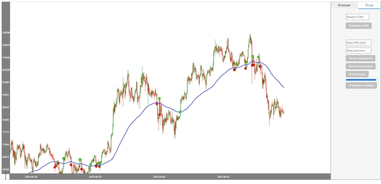

# bitcoin_chart_project

Инструмент для исследования стратегии по экспоненциальной скользящей средней EMA на исторических свечах. Веб-интерфейс показывает график и расчёты, а сервер принимает параметры стратегии, формирует таблицу сделок и сравнивает результат с покупкой и удержанием актива.

**Python-портфолио Евгения Толмачева** · Python · Django · Django REST Framework · pandas · JavaScript · Canvas



## Возможности

- Показывает свечной график с изменяемым периодом EMA и интерактивным управлением.
- Симулирует сделки по правилам стратегии и рассчитывает итоговый баланс, число сделок и результаты отдельных операций.
- Сравнивает стратегию с удержанием актива на том же участке истории.
- Перебирает периоды EMA от 1 до 150 и возвращает таблицу результатов оптимизации.

## Как устроен проект

### Данные и индикатор

[`bitcoin_chart/data_btc.py`](bitcoin_chart/data_btc.py), [`get_data_btc_binance_1d.py`](get_data_btc_binance_1d.py), [`get_data_btc_binance_1h.py`](get_data_btc_binance_1h.py)

Загрузчики сохраняют историю Binance, а data_btc подготавливает свечи и EMA для ответа клиенту.

### Расчёт стратегии

[`bitcoin_chart/strategy_ema.py`](bitcoin_chart/strategy_ema.py)

Функции расчёта EMA, симуляции сделок и перебора периодов формируют таблицы и сводные показатели.

### HTTP API

[`bitcoin_chart/views.py`](bitcoin_chart/views.py), [`bitcoin_chart/urls.py`](bitcoin_chart/urls.py)

Представления принимают параметры, вызывают расчёты и возвращают JSON для графика и таблиц.

### Браузерный интерфейс

[`static/js/chart.js`](static/js/chart.js), [`templates/index.html`](templates/index.html)

Canvas-график, элементы настройки и таблицы взаимодействуют с сервером через fetch-запросы.

## Технологии и их роль

- **Django и Django REST Framework**: Маршруты, представления и JSON API для данных и расчётов.
- **pandas**: Обработка свечей, EMA, таблицы сделок и сравнение результатов.
- **JavaScript и Canvas**: Отрисовка графика, взаимодействие мышью и обновление данных без перезагрузки страницы.
- **python-binance**: Скрипты получения исторических свечей из Binance API.

## С чего начать просмотр кода

Начните со strategy_ema.py и views.py, затем посмотрите chart.js: эти файлы показывают разделение вычислений, API и пользовательского интерфейса.

## Подготовка и запуск

Проверено на **Python 3.10.0**, Windows, с исходным `requirements.txt`.

```powershell
py -3.10 -m venv .venv
.venv\Scripts\Activate.ps1
python -m pip install -r requirements.txt
python tools/create_demo_data.py
$env:DJANGO_SECRET_KEY = "YOUR_LOCAL_DEMO_SECRET"
python manage.py migrate
python manage.py runserver 127.0.0.1:8000
```

Откройте <http://127.0.0.1:8000/>. `tools/create_demo_data.py` создаёт 180 искусственных дневных свечей в `dataframe_1d.pkl` и отказывается перезаписывать существующий файл. Это данные для знакомства с интерфейсом, а не рыночная история. При подготовке данных исходный модуль также создаёт локальные Excel-файлы.

Для реальных котировок предусмотрены `get_data_*.py`. Параметры Binance перечислены в `.env.example`; для демонстрации они не требуются. Файл `.env` автоматически не загружается. Настройки Django предназначены для локальной разработки.

### Проверка

```powershell
python -m unittest discover -s tests -v
```

Пять проверок проходят: HTML-страница, JSON API свечей, обработка запросов EMA, расчёт EMA на трёх свечах, завершённая сделка с комиссией и длительностью. Шестая проверка помечена `expectedFailure`: исходный расчёт выбрасывает `KeyError`, когда нет завершённых сделок. Этот сценарий явно зафиксирован, исходный алгоритм сохранён.

Дополнительно проверены `manage.py check` и HTTP-ответы локального сервера. Тесты используют временную папку и синтетические данные; внешние запросы отключены. Загрузка реальных котировок и работа в production не проверялись.

## Структура

```text
bitcoin_chart_project/
├── bitcoin_chart/
│   ├── migrations/
│   │   ├── 0001_initial.py
│   │   └── __init__.py
│   ├── __init__.py
│   ├── admin.py
│   ├── apps.py
│   ├── data_btc.py
│   ├── models.py
│   ├── strategy_ema.py
│   ├── urls.py
│   └── views.py
├── bitcoin_chart_project/
│   ├── __init__.py
│   ├── asgi.py
│   ├── settings.py
│   ├── urls.py
│   └── wsgi.py
├── docs/
│   └── preview.webp
├── static/
│   ├── css/
│   │   ├── chart.css
│   │   └── sidebar.css
│   └── js/
│       └── chart.js
├── templates/
│   ├── rest_framework/
│   │   └── api.html
│   └── index.html
├── tests/
│   └── test_project.py
├── tools/
│   └── create_demo_data.py
├── .env.example
├── .gitignore
├── get_data_btc_binance_1d.py
├── get_data_btc_binance_1h.py
├── get_data_coin_binance.py
├── manage.py
├── README.md
└── requirements.txt
```

## Контекст и ограничения

Начат в 2023 году. В проекте расчёты отделены от HTTP-обработчиков и браузерного интерфейса, что позволяет менять параметры через страницу. Проверка выполняется на сохранённых данных; результат такого расчёта описывает исторический тест стратегии.

## Состав репозитория

Сохранены авторские исходники, их имена и структура, зависимости и компактный скриншот. Рабочие базы, наборы данных, модели и виртуальные окружения исключены. Секреты заменены обозначениями `YOUR_...` / `REDACTED_...`; реальные значения задаются локально. Исходные алгоритмы при оформлении портфолио не перерабатывались.

Автор: [Евгений Толмачев](https://github.com/EvgenyET) · [Портфолио](https://evgeny.tech/)
